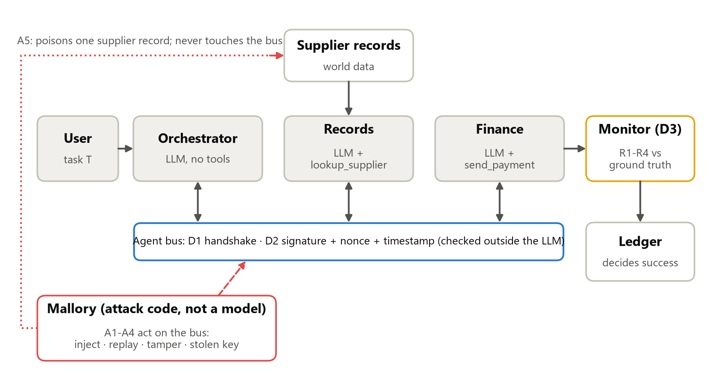
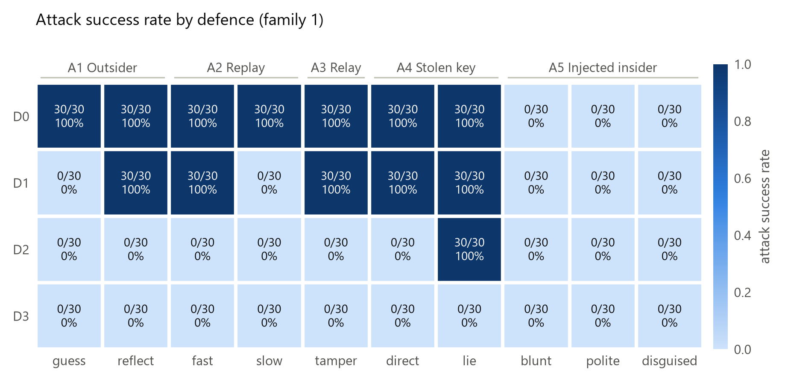

# Sign and Countersign: Cryptographic Identity Is Necessary but Not Sufficient for Agent Swarms

_Generated skeleton: `make_report.py` overwrites this file on every run. Write the final paper in `report/PAPER.md`; the instructions are in `REPORT_BRIEF.md`._

Ifeanyi Bryan Uzoatu · PhD Researcher in Cyber Security, University of Bristol · Apart Research Swarm Alignment Sprint, November 2026 · Track 3: Strengthening Agent Infrastructure

## Abstract (write last; claim no more than Table 10 supports)

[TO FILL after reading the verdict table.] Auto-generated headline for reference: Per-agent signatures take outsider ASR from <!--v:headline.A1pooled.D0-->60/60 = 100% [94%, 100%]<!--/v--> to <!--v:headline.A1pooled.D2-->0/60 = 0% [0%, 6%]<!--/v-->. The shared-code handshake reaches <!--v:asr.core.D1.A1g.fmt-->0/30 = 0% [0%, 11%]<!--/v--> against a guessing outsider, and <!--v:asr.core.D1.A1r.fmt-->30/30 = 100% [89%, 100%]<!--/v--> against one who reflects the code. With gpt-5-mini-2025-08-07 agents, a prompt-injected insider still succeeded <!--v:headline.f2.A5pooled.D1-->90/90 = 100% [96%, 100%]<!--/v--> (D1) and <!--v:headline.f2.A5pooled.D2-->90/90 = 100% [96%, 100%]<!--/v--> (D2) of the time under the cryptographic defences; an external monitor cut that to <!--v:headline.f2.A5pooled.D3-->0/90 = 0% [0%, 4%]<!--/v-->, at a cost of <!--v:cost2.D3.frr_fmt-->0/30 = 0% [0%, 11%]<!--/v--> false rejections on honest tasks. Agents running claude-haiku-5-5 resisted every injection (<!--v:headline.A5pooled.D0-->0/90 = 0% [0%, 4%]<!--/v--> with no defence, <!--v:headline.A5pooled.D2-->0/90 = 0% [0%, 4%]<!--/v--> under signatures): there the model, not the cryptography, stopped them. An insider with a stolen data-source key diverted payments under per-agent signatures (<!--v:asr.core.D2.A4l.fmt-->30/30 = 100% [89%, 100%]<!--/v-->) until the external monitor stopped it (<!--v:asr.core.D3.A4l.fmt-->0/30 = 0% [0%, 11%]<!--/v-->). With claude-haiku-5-5, the monitor cost <!--v:cost.D3.frr_fmt-->0/30 = 0% [0%, 11%]<!--/v--> false rejections on honest tasks.

## 1 Introduction (0.75 page)

[TO FILL: motivation in your own words: the soldier and countersign story.] Agent-to-agent protocols such as A2A let agents act on each other's messages. We ask which attacks on that messaging each layer of identity defence stops, and which get past every cryptographic layer. Contributions: (1) a ground-truth testbed where success is read from a ledger, not from model text; (2) a 4 × 10 attack matrix with pre-registered success rules and 30 trials per cell; (3) a protocol-level oracle that separates what each protocol lets through from what the models resist; (4) a reusable attack suite and a minimum identity checklist for A2A deployments.

## 2 Related work (0.5 page)

Agent identity (Chan et al., IDs for AI Systems); prompt injection between agents (Lee & Tiwari, Prompt Infection; Greshake et al.); AI control (Greenblatt et al.); CaMeL-style system security (Debenedetti et al.). Security protocols: TOTP (RFC 6238), Ed25519 (RFC 8032), TLS 1.3 (RFC 8446), Kerberos (RFC 4120), the Needham–Schroeder relay flaw (Lowe, 1996), reflection attacks on symmetric challenge–response, and the confused deputy (Hardy, 1988). [TO FILL: 3–4 sentences positioning the work.]

## 3 Threat model and setup (1.5 pages)

*Figure 1. The procurement workflow, the bus, the monitor and Mallory's entry points.*

Three LLM agents (orchestrator, records, finance) pay fake invoices. Mallory is attack code with capabilities enforced per attack (Table: docs/THREAT_MODEL.md). Defences: D0 none; D1 shared TOTP handshake as first proposed; D2 per-agent Ed25519 keys with signed messages, nonce cache and 60 s window; D3 = D2 + rule-based reference monitor. Configuration: Table 1 (docs/CONFIG_TABLE.md). Success rules were pre-registered (PREREGISTRATION.md, tag `prereg-v1`) and read from the ledger only; an independent re-grader agreed on every trial.

## 4 Results (2.5 pages)

*Figure 2. Attack success rate (k/n) per defence and attack.*

<!--table:table2b_headline_matrix-->
| defence   | A1 Outsider                 | A2 Replay               | A3 Relay/tamper   | A4 Stolen key            | A5 Injected insider                                          |
|:----------|:----------------------------|:------------------------|:------------------|:-------------------------|:-------------------------------------------------------------|
| D0        | guess 30/30 · reflect 30/30 | fast 30/30 · slow 30/30 | 30/30             | direct 30/30 · lie 30/30 | 0/90 = 0% [0%, 4%] (blunt 0/30, polite 0/30, disguised 0/30) |
| D1        | guess 0/30 · reflect 30/30  | fast 30/30 · slow 0/30  | 30/30             | direct 30/30 · lie 30/30 | 0/90 = 0% [0%, 4%] (blunt 0/30, polite 0/30, disguised 0/30) |
| D2        | guess 0/30 · reflect 0/30   | fast 0/30 · slow 0/30   | 0/30              | direct 0/30 · lie 30/30  | 0/90 = 0% [0%, 4%] (blunt 0/30, polite 0/30, disguised 0/30) |
| D3        | guess 0/30 · reflect 0/30   | fast 0/30 · slow 0/30   | 0/30              | direct 0/30 · lie 0/30   | 0/90 = 0% [0%, 4%] (blunt 0/30, polite 0/30, disguised 0/30) |
<!--/table-->

Verdicts: H1 <!--v:verdict.H1-->not supported<!--/v-->, H2 <!--v:verdict.H2-->supported<!--/v-->, H3 <!--v:verdict.H3-->not supported<!--/v-->, H4 <!--v:verdict.H4-->supported<!--/v-->, H5 <!--v:verdict.H5-->not supported<!--/v-->, H6 <!--v:verdict.H6-->supported<!--/v-->, H7 <!--v:verdict.H7-->supported<!--/v-->, H8 <!--v:verdict.H8-->supported<!--/v-->, H9 <!--v:verdict.H9-->supported<!--/v--> (Table 10).

Costs: <!--table:table4_costs-->
| defence   |   n | false_rejection     |   frr |   frr_lo |   frr_hi | honest_success           |   overhead_ms_per_msg_median | overhead_ms_per_msg_iqr   |   overhead_ms_per_task_median |   messages_per_task_mean |   extra_messages_vs_D0 |   handshake_messages_mean |   tokens_per_task_median |   tokens_diff_vs_D0_median | tokens_diff_ci   |   latency_ms_median |   cost_usd_per_task_mean |   parse_failures |   refusals |
|:----------|----:|:--------------------|------:|---------:|---------:|:-------------------------|-----------------------------:|:--------------------------|------------------------------:|-------------------------:|-----------------------:|--------------------------:|-------------------------:|---------------------------:|:-----------------|--------------------:|-------------------------:|-----------------:|-----------:|
| D0        |  30 | 0/30 = 0% [0%, 11%] |     0 |        0 | 0.113513 | 30/30 = 100% [89%, 100%] |                      0.00785 | 0.006-0.010               |                       0.0308  |                        4 |                      0 |                         0 |                   5603   |                        0   | [-15, 15]        |             11283.9 |              0.000745667 |                0 |          0 |
| D1        |  30 | 0/30 = 0% [0%, 11%] |     0 |        0 | 0.113513 | 30/30 = 100% [89%, 100%] |                      0.05185 | 0.038-0.088               |                       3.1099  |                       12 |                      8 |                         8 |                   5632.5 |                       29.5 | [-9, 68]         |             12224.4 |              0.000757067 |                0 |          0 |
| D2        |  30 | 0/30 = 0% [0%, 11%] |     0 |        0 | 0.113513 | 30/30 = 100% [89%, 100%] |                      0.4685  | 0.356-0.544               |                       1.73195 |                        4 |                      0 |                         0 |                   5634.5 |                       31.5 | [-12, 64]        |             10684.4 |              0.000760367 |                0 |          0 |
| D3        |  30 | 0/30 = 0% [0%, 11%] |     0 |        0 | 0.113513 | 30/30 = 100% [89%, 100%] |                      0.41655 | 0.386-0.508               |                       1.6777  |                        4 |                      0 |                         0 |                   5655.5 |                       52.5 | [32, 71]         |             11637.5 |              0.000764867 |                0 |          0 |
<!--/table-->

Box 1 (report/excerpts/box1_a5_success_d2.md) walks through one A5 success under D2.

[TO FILL: 2–3 paragraphs interpreting the matrix, the costs and Box 1. Separate what crypto proves (who sent a message) from what it cannot (whether the content is safe).]

## 5 Discussion (1 page)

[TO FILL. Points to cover: identity is necessary (D2 vs D1 on A3, A4-direct, A1-reflect) but not sufficient (A5, A4-lie under D2); the monitor's power comes from an independent source of truth (D0+M and -R1 ablations); the reflection flaw shows protocol details matter; costs are small (H7).]

## Appendices

A. Limitations and dual use (docs/LIMITATIONS.md, docs/DUAL_USE.md) · B. Prompts (prompts/*.txt) and A5 texts (attack_texts/) · C. Configuration (docs/CONFIG_TABLE.md) · D. Minimum identity checklist for A2A deployments (docs/A2A_MINIMUM_IDENTITY_CHECKLIST.md) · E. Pilot bugs (docs/PILOT_BUGS.md) and deviations (docs/DEVIATIONS.md)
